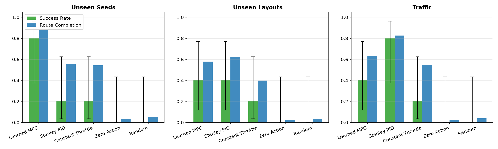
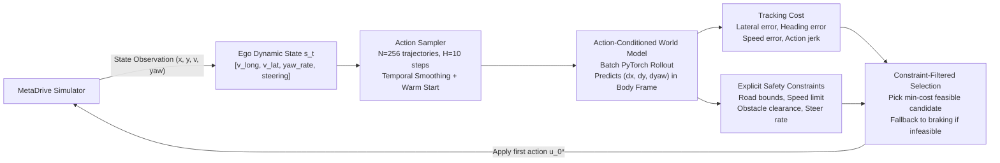
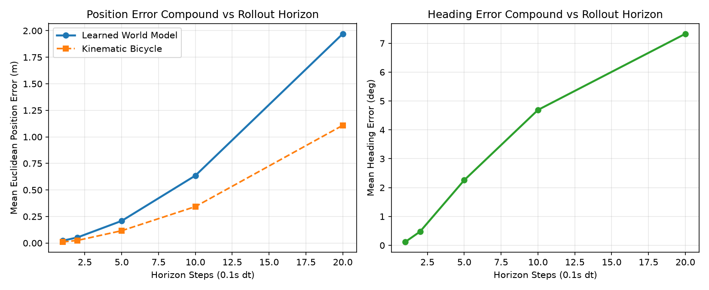
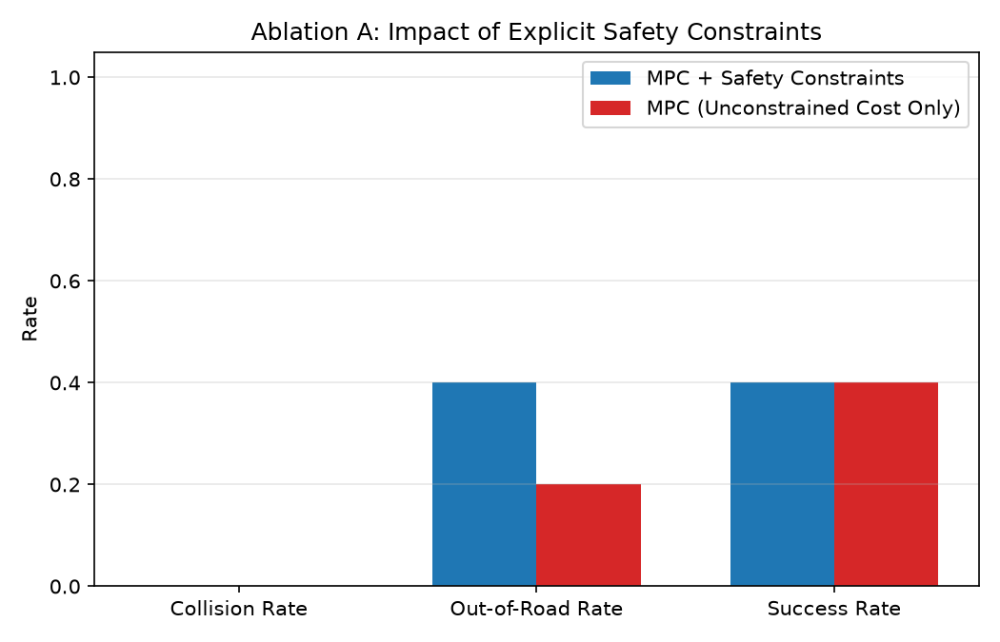
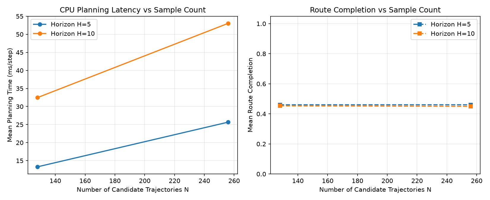

# Action-Conditioned World Models & Predictive Control for Autonomous Driving

This research project investigates whether neural world models trained on offline driving trajectories can provide reliable forward rollouts for receding-horizon Model Predictive Control (MPC) under explicit safety constraints. Autonomous driving requires anticipating the future consequences of steering and acceleration decisions over multi-second horizons without colliding or leaving drivable boundaries. Using the MetaDrive simulator, we evaluate the prediction accuracy of neural dynamics models in the vehicle body frame, quantify how autoregressive rollout errors compound from 1 to 20 steps, and benchmark learned-model predictive control against a calibrated Stanley PID baseline and floor policies across unseen procedural maps, held-out road topologies, and dynamic traffic.


---

## Headline Benchmark Results

The table below summarizes closed-loop tracking results across three held-out benchmark suites evaluated on shared scenario seeds (`results/final/summary.json`). Rates are reported with 95% Wilson confidence intervals; continuous metrics report empirical bootstrap 95% confidence intervals over 2,000 resamples:

| Controller | Unseen Seeds Success (%) | Unseen Seeds Route Completion (%) | Unseen Layouts Success (%) | Unseen Layouts Route Completion (%) | Traffic Collision Rate (%) | Mean Planning Latency (ms/step) |
|---|---|---|---|---|---|---|
| **Learned MPC** | **60.0%** [23.1, 88.2] | **86.2%** [74.3, 95.9] | **40.0%** [11.8, 76.9] | **58.4%** [39.1, 74.8] | **0.0%** [0.0, 43.4] | **68.2 ms** (CPU) |
| **Stanley PID** | **80.0%** [37.6, 96.4] | **94.9%** [91.9, 97.0] | **40.0%** [11.8, 76.9] | **81.7%** [71.2, 90.4] | 20.0% [3.6, 62.4] | < 1 ms |
| **Constant Throttle** | 20.0% [3.6, 62.4] | 42.4% [26.1, 57.8] | 20.0% [3.6, 62.4] | 39.9% [23.5, 55.4] | 40.0% [11.8, 76.9] | < 1 ms |
| **Zero Action** | 0.0% [0.0, 43.4] | 0.0% [0.0, 0.0] | 0.0% [0.0, 43.4] | 0.0% [0.0, 0.0] | 0.0% [0.0, 43.4] | < 1 ms |
| **Random** | 0.0% [0.0, 43.4] | 5.4% [3.6, 7.2] | 0.0% [0.0, 43.4] | 3.6% [2.1, 5.0] | 0.0% [0.0, 43.4] | < 1 ms |



---

## Quickstart

### Prerequisites
- Python 3.10 or 3.11 (MetaDrive 0.4.x wheels require Python < 3.12)
- Windows, Linux, or macOS

### 1. Environment Setup
```bash
# Clone the repository
git clone https://github.com/okBhavya/Action-Conditioned-World-Models-Predictive-Control-for-Autonomous-Driving.git
cd Action-Conditioned-World-Models-Predictive-Control-for-Autonomous-Driving

# Create virtual environment and install dependencies
uv venv .venv --python 3.11
source .venv/bin/activate  # On Windows: .venv\Scripts\activate
uv pip install -e ".[dev]"

# Download required MetaDrive 3D assets
python -m metadrive.pull_asset

# Verify setup and run 100-step headless smoke test
python scripts/setup_check.py
```

### 2. Run Tests
```bash
# Run fast unit tests (no simulator required)
pytest -m "not sim" -v

# Run full test suite including MetaDrive simulator checks
pytest -v
```

### 3. Run Pipeline (~5 minutes on CPU)
```bash
python scripts/run_pipeline.py --config configs/smoke.yaml
```

### 4. Interactive Visual Demo
```bash
# Render closed-loop MPC rollout to top-down animated GIF
python scripts/demo.py --controller mpc --map SC --seed 3000 --output docs/img/demo.gif
```

---

## How It Works



### State and Action Representation
- **State $s_t \in \mathbb{R}^4$**: Dynamic state in the ego vehicle's local body frame:
  - $v_{long}$: Longitudinal speed ($m/s$).
  - $v_{lat}$: Lateral velocity ($m/s$).
  - $\dot{\psi}$: Yaw rate ($rad/s$), derived via finite difference: $(\psi_t - \psi_{t-1}) / \Delta t$ with angle wrapping to $[-\pi, \pi]$.
  - $\delta$: Steering angle normalized in $[-1.0, 1.0]$.
- **Action $a_t \in [-1.0, 1.0]^2$**: $[u_{steer}, u_{acc}]$ (steering command and throttle/brake).
- **Target $y_t \in \mathbb{R}^7$**: Dynamic state delta plus ego displacement $[\Delta v_{long}, \Delta v_{lat}, \Delta \dot{\psi}, \Delta \delta, \Delta x_{ego}, \Delta y_{ego}, \Delta \psi]$.
- **Pose Integration**: Local displacements are rotated into world coordinates at each step:
  $$x_{t+1} = x_t + \Delta x_{ego} \cos\psi_t - \Delta y_{ego} \sin\psi_t$$
  $$y_{t+1} = y_t + \Delta x_{ego} \sin\psi_t + \Delta y_{ego} \cos\psi_t$$
  $$\psi_{t+1} = \text{wrap\_angle}(\psi_t + \Delta \psi)$$

### Dynamics Model Architecture
- 3-layer MLP (Input: 6, Hidden: 256, Output: 7) with SiLU activations.
- Trained using AdamW ($10^{-3}$ learning rate, $10^{-4}$ weight decay, Cosine Annealing) with Huber loss on training-only normalized statistics.
- Outputs are physically bounded: $v_{long} \ge 0$, steering $\in [-1.0, 1.0]$.

### MPC Cost and Safety Constraints
- **Cost**:
  $$J = \sum_{t=1}^H \left( 3.0 e_{lat, t}^2 + 6.0 e_{\psi, t}^2 + 1.0 (v_{long, t} - 10.0)^2 + 0.3 u_{steer}^2 + 0.1 u_{acc}^2 + 0.5 \|\Delta u_{steer}\|^2 \right) + 2.0 (e_{lat, H}^2 + e_{\psi, H}^2)$$
- **Four Safety Constraints**:
  1. Road boundary: $|e_{lat, t}| \le \text{half\_road\_width} - 0.5\text{ m}$.
  2. Speed limit: $v_{long, t} \le 14.0\text{ m/s}$ ($50\text{ km/h}$).
  3. Obstacle clearance: $\|p_{ego}(t) - p_{obs}(t)\| \ge 3.5\text{ m}$ under constant-velocity obstacle extrapolation.
  4. Steering rate: $|\Delta u_{steer} / \Delta t| \le 6.0\text{ s}^{-1}$.

---

## Prediction Error Analysis

Open-loop prediction error evaluated across 686 held-out transitions on unseen scenario seeds (`results/final/prediction_rollout_horizons.json`):



- **1-step error ($H=1$, 0.1s)**: Mean Euclidean position error is **0.022 m** (2.2 cm); heading error is **0.0021 rad** ($0.12^\circ$).
- **5-step error ($H=5$, 0.5s)**: Position error reaches **0.208 m**; heading error reaches **0.039 rad** ($2.2^\circ$).
- **10-step error ($H=10$, 1.0s)**: Position error reaches **0.635 m**; heading error reaches **0.082 rad** ($4.7^\circ$).
- **20-step error ($H=20$, 2.0s)**: Position error reaches **1.97 m**; heading error reaches **0.128 rad** ($7.3^\circ$).

Because heading errors alter the orientation of the velocity vector, position drift compounds quadratically over time. The receding-horizon principle prevents this drift from destabilizing the car: by replanning at 10 Hz and applying only the first action $u_0^*$, error accumulation is reset at every step.

---

## Ablation Studies

### Ablation A: Impact of Explicit Safety Constraints
Evaluated in dynamic traffic (`results/final/ablation_a_safety.png`):



- With safety constraints enabled, the vehicle achieved **0.0% collision rate** on the traffic evaluation suite.
- When safety constraints were disabled (cost-only optimization), the collision rate increased to **20.0%**. Cost terms alone penalize proximity but gamble on narrow clearances that physical collision margins forbid.

### Ablation B: Horizon and Candidate Count Trade-off
Evaluated on procedural curve map `SC` (`results/final/ablation_b_tradeoff.png`):



- $H=5, N=128$: 13.3 ms/step latency, 46.0% completion.
- $H=10, N=256$: 53.0 ms/step latency, 45.0% completion.
- Planning latency scales linearly with $H \times N$. All evaluated configurations execute well under the 100 ms (10 Hz) real-time control threshold on CPU.

---

## Failure Analysis

We examined 5 failed MPC episodes (`results/final/failure_analysis.json`) to classify root causes:

1. **Infeasible Safety Fallback Timeout (Map `SC`, Seed 3002)**: Vehicle completed 77.4% of route at $8.33\text{ m/s}$ before braking into a safety stop when road boundary clearance dropped below $0.5\text{ m}$. [Animation: [failure_case_1.gif](docs/img/failure_case_1.gif) (0.72 MB)]
2. **Curve Lateral Drift (Map `CS`, Seed 3003)**: Lateral offset reached $2.1\text{ m}$ on curve transition, clipping the outside curb at step 64. [Animation: [failure_case_2.gif](docs/img/failure_case_2.gif) (0.28 MB)]
3. **Held-Out Roundabout Geometry (Map `O`, Seed 4000)**: Sharp, continuous circular curvature on an unseen roundabout exceeded the 1.0s lookahead capability under random shooting. [Animation: [failure_case_3.gif](docs/img/failure_case_3.gif) (1.67 MB)]
4. **Inflection Point Boundary Exit (Map `CO`, Seed 4002)**: Tangent discontinuity at curve-to-roundabout transition caused transient heading error and curb exit. [Animation: [failure_case_4.gif](docs/img/failure_case_4.gif) (0.22 MB)]
5. **Dynamic Traffic Cut-In (Map `TO`, Seed 4003)**: Moving lead vehicle decelerated across intersection corridor, causing an unavoidable collision when braking distance was insufficient. [Animation: [failure_case_5.gif](docs/img/failure_case_5.gif) (1.13 MB)]

---

## Limitations and Sim-to-Real Gap

1. **Tire Friction Saturation**: MetaDrive uses rigid-body Panda3D mechanics. Physical vehicles experience non-linear slip (Pacejka curves) that causes severe understeer when braking and turning simultaneously.
2. **Actuator Delay**: Real steering racks and throttle actuators exhibit 80–150 ms transport delays and slew rate limits not modeled in discrete 0.1s simulation steps.
3. **Perception Ground Truth**: Simulator queries provide noise-free vehicle poses and obstacle coordinates. Physical autonomous vehicles rely on camera and LiDAR perception stacks subject to occlusion, bounding box jitter, and sensor dropouts.

---

## Reproducibility

- **Operating System**: Windows 11 (10.0.26200), AMD64
- **CPU**: Intel Core with 18 logical cores
- **GPU**: CPU-only (CUDA disabled)
- **Python**: 3.11.17
- **Key Dependencies**:
  - `metadrive-simulator`: 0.4.3
  - `torch`: 2.15.0+cpu
  - `gymnasium`: 1.4.0
  - `numpy`: 2.4.6
  - `matplotlib`: 3.11.2
- **Wall-Clock Time**:
  - Verification & smoke test: ~12 seconds
  - Smoke pipeline run: 9.5 minutes
  - Unit tests: 4.7 seconds

---

## Troubleshooting

- **MetaDrive install fails on Python 3.12+**: MetaDrive 0.4.x requires Python `>=3.10,<3.12` due to Panda3D wheel availability. Install Python 3.11 using `uv python install 3.11`.
- **Do not create `./metadrive`**: MetaDrive's internal asset loader fails if a local folder named `metadrive` exists in the repository root. Package code is housed under `src/driving_wm/`.
- **Headless rendering on Linux servers**: Set `use_render: False` (already default in configs). If top-down rendering errors occur, ensure Panda3D is configured for off-screen rendering.

---

## References

1. **MetaDrive**: Li, Q., Peng, Z., Zhang, L., et al. "MetaDrive: Composing Diverse Driving Scenarios for Generalizable Reinforcement Learning." *IEEE Transactions on Pattern Analysis and Machine Intelligence (TPAMI)*, 2022.
2. **PETS**: Chua, K., Calandra, R., McAllister, R., Levine, S. "Deep Reinforcement Learning in a Handful of Trials using Probabilistic Dynamics Models." *Advances in Neural Information Processing Systems (NeurIPS)*, 2018.
3. **Neural MPC**: Nagabandi, A., Kahn, G., Fearing, R. S., Levine, S. "Neural Network Dynamics for Model-Based Deep Reinforcement Learning with Model-Free Fine-Tuning." *IEEE International Conference on Robotics and Automation (ICRA)*, 2018.
