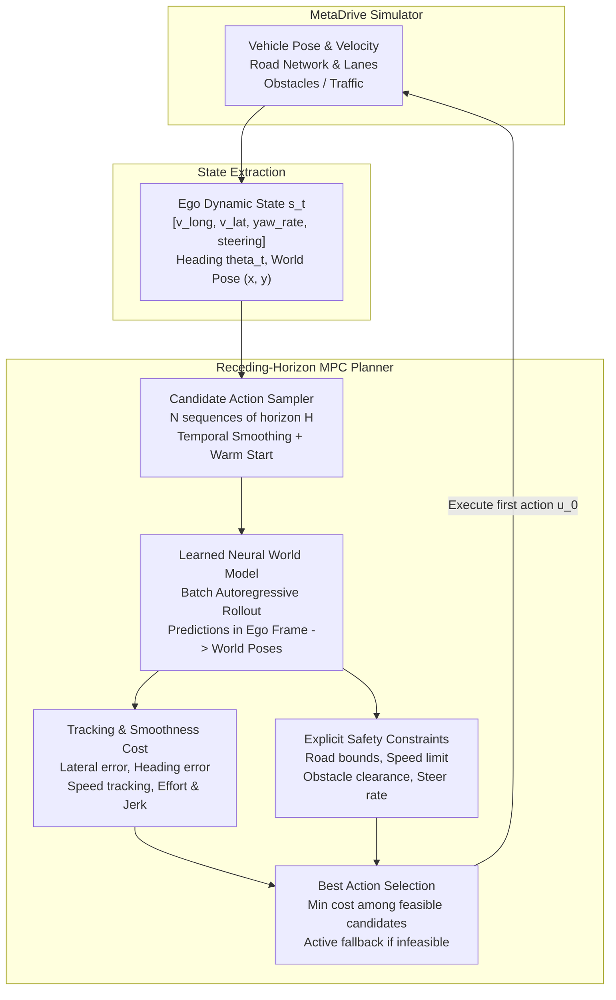

# System Architecture

## Overview

This project implements an action-conditioned neural world model coupled with a receding-horizon Model Predictive Control (MPC) planner for autonomous driving in the MetaDrive simulator. The system predicts vehicle dynamics and pose increments in the ego body frame, unrolls future trajectories through batch forward simulation, evaluates a composite tracking and smoothness cost, and applies explicit safety constraints to filter out hazardous candidate controls.

---

## State and Action Representation

### 1. Ego-Body Dynamic State ($s_t \in \mathbb{R}^4$)
Dynamics are formulated strictly in the ego vehicle's body frame to ensure invariance to map orientation and geometry:
- $v_{long}$: Longitudinal velocity ($m/s$). Forward direction along vehicle heading.
- $v_{lat}$: Lateral velocity ($m/s$). Transverse direction (left is positive).
- $\dot{\psi}$: Yaw rate ($rad/s$). Rate of change of heading angle, derived via finite difference over control step $\Delta t = 0.1\text{s}$ with angle wrapping:
  $$\dot{\psi}_t = \frac{\text{wrap\_angle}(\psi_t - \psi_{t-1})}{\Delta t}$$
- $\delta$: Normalized steering state in $[-1.0, 1.0]$.

### 2. Control Action ($a_t \in [-1.0, 1.0]^2$)
- $u_{steer} \in [-1.0, 1.0]$: Steering command (-1 full right, +1 full left).
- $u_{acc} \in [-1.0, 1.0]$: Throttle / brake command (+1 full throttle, -1 full brake).

### 3. Prediction Target ($y_t \in \mathbb{R}^7$)
The neural network predicts normalized transitions over one control step $\Delta t = 0.1\text{s}$:
$$y_t = \begin{bmatrix} \Delta v_{long} & \Delta v_{lat} & \Delta \dot{\psi} & \Delta \delta & \Delta x_{ego} & \Delta y_{ego} & \Delta \psi \end{bmatrix}^T$$
where:
- $\Delta v_{long}, \Delta v_{lat}, \Delta \dot{\psi}, \Delta \delta$: Increments of dynamic state.
- $\Delta x_{ego}, \Delta y_{ego}$: World position displacement rotated into the ego frame at time $t$:
  $$\Delta x_{ego} = (x_{t+1} - x_t) \cos\psi_t + (y_{t+1} - y_t) \sin\psi_t$$
  $$\Delta y_{ego} = -(x_{t+1} - x_t) \sin\psi_t + (y_{t+1} - y_t) \cos\psi_t$$
- $\Delta \psi = \text{wrap\_angle}(\psi_{t+1} - \psi_t)$: Heading change over the step.

---

## Neural World Model Architecture

The dynamics model is a multi-layer perceptron (MLP) mapping normalized inputs to normalized delta targets:
- Input: $\tilde{s}_t \in \mathbb{R}^4$ (normalized state) concatenated with $a_t \in \mathbb{R}^2 \implies \mathbb{R}^6$.
- Backbone: 3 fully-connected layers with 256 hidden units and SiLU (Swish) non-linearities.
- Normalization: Inputs and targets are normalized using mean $\mu$ and standard deviation $\sigma$ computed strictly on the training split, with variance floored at $\epsilon = 10^{-4}$ to prevent division by zero on static dimensions.
- Output: Denormalized prediction $\hat{y}_t \in \mathbb{R}^7$.
- Physical Constraints:
  - $v_{long, t+1} = \max(0.0, v_{long, t} + \Delta v_{long})$ (prevents vehicles from spontaneously reversing under forward braking).
  - $\delta_{t+1} = \text{clip}(\delta_t + \Delta \delta, -1.0, 1.0)$.

### Rollout Kinematics
Given initial world pose $(x_0, y_0, \psi_0)$ and candidate actions $a_0, \dots, a_{H-1}$, poses are integrated forward in time:
$$x_{t+1} = x_t + \Delta x_{ego, t} \cos\psi_t - \Delta y_{ego, t} \sin\psi_t$$
$$y_{t+1} = y_t + \Delta x_{ego, t} \sin\psi_t + \Delta y_{ego, t} \cos\psi_t$$
$$\psi_{t+1} = \text{wrap\_angle}(\psi_t + \Delta \psi_t)$$

---

## MPC Cost Formulation

For a candidate rollout of horizon $H$ with candidate actions $a_0, \dots, a_{H-1}$:
$$J = \sum_{t=1}^H \left( w_{lat} e_{lat, t}^2 + w_{\psi} e_{\psi, t}^2 + w_v (v_{long, t} - v_{ref})^2 + w_u \|a_t\|^2 + w_{\Delta u} \|\Delta a_t\|^2 \right) + w_{term} (e_{lat, H}^2 + e_{\psi, H}^2)$$

- $e_{lat, t}$: Lateral distance from projected vehicle position $(x_t, y_t)$ to the reference lane centerline.
- $e_{\psi, t} = \text{wrap\_angle}(\psi_t - \psi_{lane}(s_t))$: Heading error relative to the lane tangent heading at the projected longitudinal progress.
- $v_{ref}$: Target forward speed ($10.0\text{ m/s} \approx 36\text{ km/h}$).
- $w_{\Delta u}$: Penalty on action rate of change between consecutive steps, ensuring smooth steering and throttle execution.

---

## Explicit Safety Constraints

Each trajectory candidate is evaluated against four independent safety constraints:

1. **Road Bounds Constraint**:
   $$|e_{lat, t}| \le \frac{W_{road}}{2} - d_{margin}, \quad \forall t \in \{1, \dots, H\}$$
   where $W_{road}$ is the total road width and $d_{margin} = 0.5\text{ m}$.

2. **Speed Limit Constraint**:
   $$v_{long, t} \le v_{max} = 14.0\text{ m/s} \quad (\approx 50\text{ km/h})$$

3. **Obstacle & Vehicle Clearance Constraint**:
   Surrounding traffic participants are projected using constant-velocity extrapolation:
   $$p_{obs}(t) = p_{obs}(0) + v_{obs} \cdot t \cdot \Delta t$$
   $$\|p_{ego}(t) - p_{obs}(t)\| \ge d_{clearance} = 3.5\text{ m}, \quad \forall t \in \{1, \dots, H\}$$

4. **Steering Rate Constraint**:
   $$\left| \frac{u_{steer, t} - u_{steer, t-1}}{\Delta t} \right| \le 6.0\text{ s}^{-1}$$

### Feasibility and Fallback Logic
- If feasible candidate trajectories exist ($\ge 1$), the candidate minimizing cost $J$ is selected.
- If all sampled candidates violate constraints, the least-violating candidate is selected, and an active safety fallback engages: gentle braking ($u_{acc} = -0.5$) and steering proportionally toward the lane centerline.
